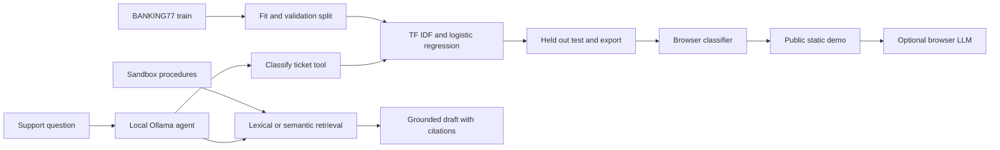

# SupportOps AI architecture

## Scope and acceptance
1. Download original public BANKING77 splits and validate their hashes.
2. Fit TF-IDF and logistic regression on the fitting split only. Select C and the abstention threshold on validation. Evaluate the selected model on the original held-out test with exact overlaps removed and counted.
3. Export weights, vocabulary and IDF without executable pickle; check Python and browser/Node numerical parity.
4. Retrieve short bilingual sandbox runbooks with explicit lexical/semantic modes.
5. Run a real local Ollama model using read-only classification and retrieval tools. Publish the raw synthetic-question trace and inspect citations.
6. Publish a no-key, free static demo and source repository. The demo must never pretend that a replay is live inference.

## Data flow

## ADR 001 Small supervised baseline before fine tuning
Decision: TF-IDF plus logistic regression on 77 English intents, with a majority baseline. A small model is trainable locally, interpretable and exportable. It does not imply Portuguese classification or modern transformer benchmark superiority. The LLM is pretrained and is not fine-tuned here.

## ADR 002 Free publication without an inference bill
Decision: GitHub Pages serves only static files. The classifier runs on-device. An optional WebLLM model runs on the visitor's WebGPU device; users opt in to a large model download. No account or paid API is required. Local Ollama is the richer reference implementation. A static demo cannot expose Python endpoints online; the UI labels the mode.

## ADR 003 Bounded read only agent
Decision: exactly two permitted tools, validated schemas, at most four model turns. No shell, arbitrary URL fetching, account access or financial operations. Citation ID validation checks provenance membership only; semantic entailment and all prompt injection resistance are not proven by that check. Invalid outputs require review.

## Security review
Public data and fictional knowledge only. No uploads, passwords, API keys or customer history. The local API binds to loopback, validates input, rejects unexpected fields and cross-origin POSTs, limits calls, and serializes model access. Browser output is rendered as text. External model/package downloads have upstream privacy and availability dependencies. Logs exclude user request bodies. Model unavailability yields an explicit error, never a simulated answer.

## Evaluation limits
Public benchmark metrics do not establish production readiness. Exact normalization catches duplicates but not all semantic overlap. The supervised score is not a calibrated correctness probability. The curated RAG checks are smoke tests, not a representative customer benchmark. Actual tool traces are recorded; reviewers must still judge usefulness and factual support.
